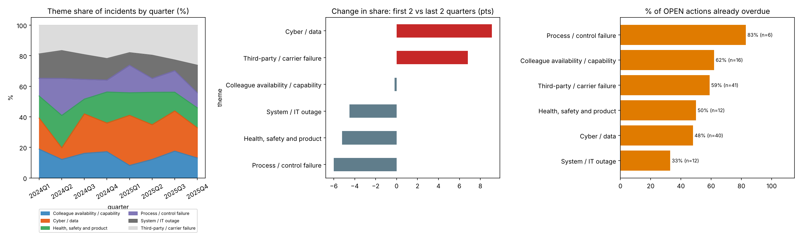

# NLP on incidents and audit actions

> Turn free-text incident and audit records into themes, trends and overdue-action hotspots using topic modelling (synthetic data).




**Problem.** Incident and audit logs hold hundreds of free-text records. Counting by category hides what is changing.
Which themes recur, which are growing, and where are actions going overdue?

**Approach.**
1. Generated 506 synthetic incident/audit records over 8 quarters across 6 themes (third party, IT outage, process/control, colleague availability, health and safety, cyber/data). Two themes were deliberately made to grow so the method can be checked.
2. TF-IDF text features, then NMF topic modelling (unsupervised). Topics are labelled by an analyst from their top terms.
3. Trend analysis (share of incidents, first two vs last two quarters) and an open-action ageing view (share of open actions already past due date).

**Results.**
- Fastest growing: Cyber/data (+9.1 points of share) and Third-party/carrier failure (+6.8 points). Both were planted, and the method recovered them.
- Open actions: Third-party (41 open, 59% overdue) and Cyber (40 open, 48% overdue) combine growth with a large backlog. Process/control has the worst overdue rate (83%) but only 6 open actions.
- Recovered themes matched the hidden labels perfectly (100% purity).

**What I would tell leadership.** Two themes are both growing and carrying the biggest action backlog: third-party and cyber.
Prioritise closure of those actions and check whether the actions address root cause or just the symptom.

**Limitations.** The 100% match is because synthetic text is much cleaner than real incident text. Real logs need cleaning,
more topics, manual review of a sample, and coverage checks. Treat topics as a triage aid, not a classification of record.

Files: `incident_nlp.py`, `incident_themes.png`, `theme_summary.csv`, `classified_incidents.csv`, `synthetic_incidents.csv`.

## Run it
```
pip install -r requirements.txt
python3 incident_nlp.py
```
Fixed random seeds, so results reproduce exactly. All data is synthetic or assumption-based; no real company data is used.

Part of a series of data-driven risk and operational resilience projects by Suhas Suresha.
